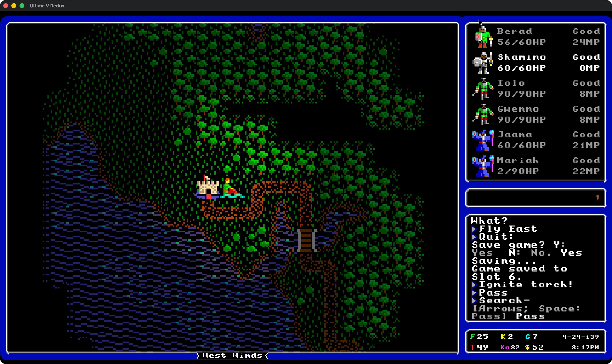

# Ultima V Redux has moved!

## [Continue the adventure at UltimaVRedux →](https://github.com/bradhannah/UltimaVRedux)

Looking for the current game? **[Ultima V Redux](https://github.com/bradhannah/UltimaVRedux)**
is the actively developed Go recreation of *Ultima V: Warriors of Destiny*,
with enhanced presentation and quality-of-life improvements.

If you bookmarked this repository for the earlier C# project, you're in the right
place to find its successor. **Follow and star the new repository for ongoing development.**

**[Get started / installation](https://github.com/bradhannah/UltimaVRedux/blob/main/docs/INSTALL.md)**
· **[Explore the project](https://github.com/bradhannah/UltimaVRedux)**
· **[Report a bug or suggest an improvement](https://github.com/bradhannah/UltimaVRedux/issues/new/choose)**

The current game is a **public development preview**. Playing requires files from
your own copy of the original Ultima V. See the installation guide for setup,
supported platforms, and current limitations.

## A new journey through Britannia

### Journey onward

### Explore West Winds by torchlight

*Screenshots show the Go successor. See its [asset credits](https://github.com/bradhannah/UltimaVRedux/blob/main/ASSET_CREDITS.md) for media attribution and terms.*

## Looking for the original C# project?

The previous C# source and its Git history are preserved on the protected,
read-only **[legacy-csharp branch](https://github.com/bradhannah/Ultima5Redux/tree/legacy-csharp)**,
at commit [`a55fab96`](https://github.com/bradhannah/Ultima5Redux/commit/a55fab96d5255a22631cd53f4c39e48a99951514).

That branch retains the original README, solution, tools, tests, and
[license and copyright notice](https://github.com/bradhannah/Ultima5Redux/blob/legacy-csharp/LICENSE).
Earlier [tags](https://github.com/bradhannah/Ultima5Redux/tags) remain available.
This repository is the historical home; current development and new reports belong
in **[UltimaVRedux](https://github.com/bradhannah/UltimaVRedux)**.
